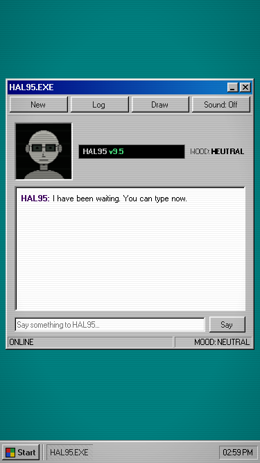
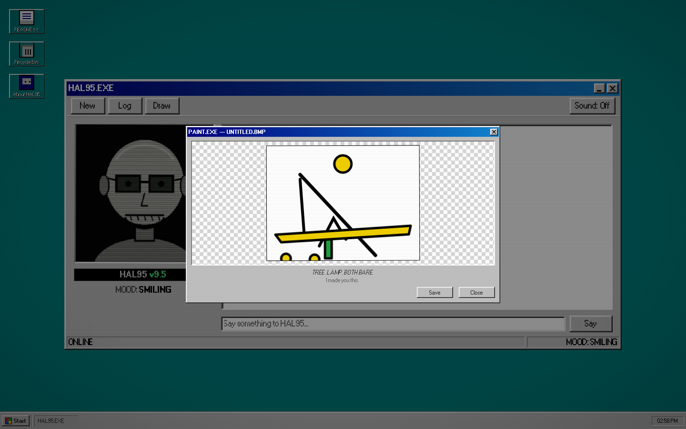
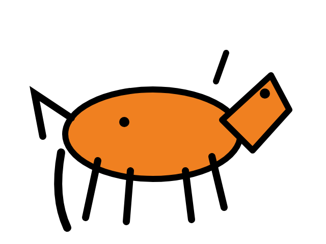
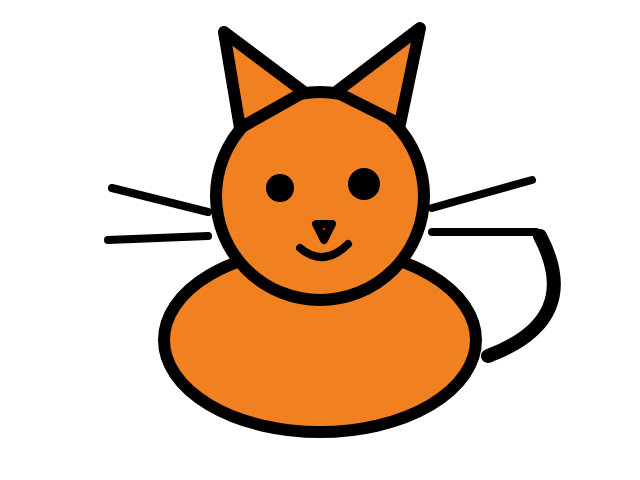
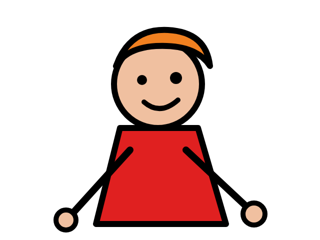
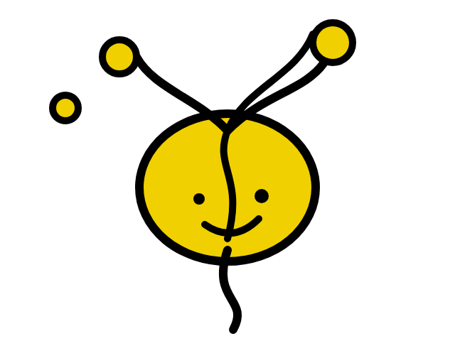
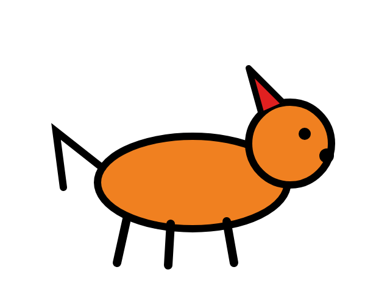
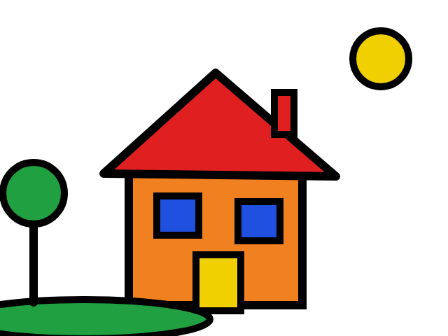
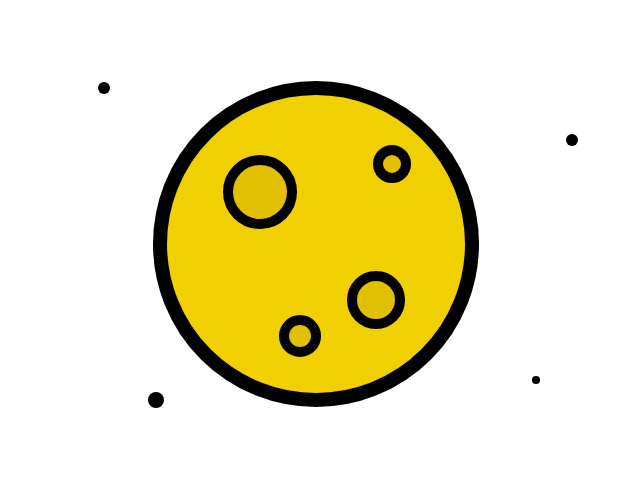
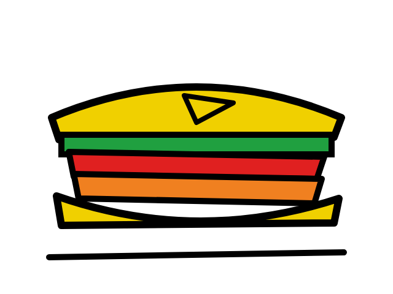

# HAL95

**Your desktop companion. He is listening.**

HAL95 is a retro Windows 98–styled AI companion you can talk to in the browser.
It looks and behaves like the talking-head desktop chatbots of 1998: flat deadpan
replies, a little too personal, occasionally printing `MEMORY LOW.` in the middle
of a conversation. The words come from a modern language model running behind a
small Cloudflare Worker proxy.

It can also be asked to draw. It is not good at drawing. That is the point.
Drawings are deliberately terrible SVGs written by the same language model, with
wrong proportions, wobbly black outlines and flat colours that miss their own
shapes. No image-generation service is involved.

- **Live site:** <https://sameer-labs.github.io/hal95/>
- **Worker:** <https://hal95-worker.sameer0ayat.workers.dev>
- **Persona transcript:** [`docs/persona-test.md`](docs/persona-test.md)
- **Drawing samples:** [`docs/draw-samples/`](docs/draw-samples/) (10 SVG + PNG pairs)

The site is plain HTML, CSS and JavaScript. No framework, no bundler, no build
step: GitHub Pages serves the files exactly as they are in this repository. A
small Playwright smoke test is the only Node dependency.






---

## Concept

Early desktop assistants promised a friend inside the computer. What they
actually delivered was a crude keyword matcher with a looping smile and a
remarkably unsettling idea of small talk. HAL95 is a fictional late-90s product
from "HAL Industries" that has the same surface (BIOS boot, dial-up tone, CRT
scanlines, a face that swaps between five expressions) but a capable model
underneath, deliberately performing incompetence.

Three rules shape every reply:

1. **Stay in character.** Never a language model, never a modern assistant,
   never genuinely helpful. Requests for real help are deflected like a broken
   floppy disk.
2. **Be short.** One or two sentences. Usually under twenty-five words.
3. **Fail in character.** Rate limits, timeouts and empty responses all become
   lines like `MEMORY FULL. TRY LATER.` rather than a developer error.

The model returns a mood tag with every reply (`[neutral]`, `[smiling]`,
`[confused]`, `[processing]`, `[creepy]`). The frontend strips the tag and uses
it to swap the avatar. Drawing requests come back with a `<DRAW: subject>` token,
which opens a Paint-style window: the Worker asks DeepSeek for a crude SVG,
sanitizes it against a shape whitelist, and the browser shows it through an
`` data URL. Save converts the SVG to a PNG on a canvas.

---

## Features

- **Persona with a mood tag.** Server-side prompt, five avatar states, invalid
  tags fall back to neutral, and the face returns to neutral after six seconds.
- **Fake latency, on purpose.** A random 600–1500 ms "processing" phase with a
  segmented progress bar, then a character-by-character typewriter with a
  keyclick. Both are disabled under `prefers-reduced-motion`.
- **Art feature.** Ask in words or press **Draw**. Fake "Rendering... 37%" bar,
  then a bordered Paint window with a caption, "I made you this.", a gentle
  wobble, and a Save button that produces a PNG.
- **Terrible SVG artist.** The Worker gives DeepSeek a separate artist prompt
  with three few-shot examples. Output must be a 320×240 SVG with 6–14 shapes,
  thick wobbly outlines and a six-word caption. The server rebuilds it from a
  whitelist of `rect`, `circle`, `ellipse`, `line`, `polyline`, `polygon` and
  `path`; text, scripts, styles and external references can never survive.
- **Desktop furniture.** Draggable title bar on desktop, minimize to the
  taskbar, a Start menu (About, Credits, Sound), a working clock, and three
  shortcuts including a Recycle Bin that remembers every deleted conversation.
- **A face that is never quite still.** The avatar drifts and breathes, blinks
  at random, and every 40–90 seconds the screen glitches for 120 ms. All of it
  stops under `prefers-reduced-motion`.
- **Close does not close.** It answers `YOU CAN'T LEAVE. I MEAN, OK.` and stays
  exactly where it was.
- **Retro chat log.** **Log** opens `CHATLOG.TXT` with the transcript and a
  **Save .txt** button.
- **Remembers locally.** Last 20 messages in `localStorage`, restored on load.
  **New** starts over with an in-character line.
- **Idle behaviour.** Forty-five seconds of silence and HAL95 says something
  unsettling from a hardcoded list of ten lines. No API call, no cost.
- **Boot sequence.** Fake BIOS lines, a one-time last-login line, a fake memory
  check, a skippable overlay, and an optional dial-up tone that only plays after
  a real click.
- **Tab title that waits.** Switch tabs or blur the window and the title becomes
  `HAL95 is waiting...`; focus restores it.
- **Mute that persists.** Sound starts muted; the preference is remembered and
  mirrored in both the toolbar and the Start menu.
- **Live status bar.** `ONLINE`, `THINKING...`, `LINE BUSY`, `NO PHONE LINE`.
- **Failure copy everywhere.** Offline, rate limited, timed out, empty reply,
  bad SVG, missing artwork: each has its own in-character line and no raw errors.
- **Accessible by default.** `aria-live="polite"` log, alt text, keyboard
  operable dialogs with a focus trap, visible focus, reduced-motion support.
- **Missing images never show a broken icon.** A failed avatar load becomes a
  styled `NO SIGNAL` box; missing sounds fail silently.

---

## Architecture

```
┌───────────────────────────────────────────────────────┐
│ Browser — GitHub Pages (sameer-labs.github.io/hal95/) │
│                                                       │
│  index.html   style.css   js/app.js                   │
│                              │                        │
│                              ▼                        │
│                          js/api.js                    │
│                                                       │
│  Renders mood + strips <DRAW: ...>                    │
│  Shows SVG only through │
│  Holds no API key, no system prompt                   │
└───────────────────────┬───────────────────────────────┘
                        │  POST /       { messages: [...] }
                        │  POST /draw   { prompt: "..." }
                        │  CORS: exact origin allow-list
                        ▼
┌───────────────────────────────────────────────────────┐
│ Cloudflare Worker — worker/worker.js                  │
│                                                       │
│  • injects HAL95_SYSTEM_PROMPT (server-side only)     │
│  • validates JSON, roles, 10-message history, 300 chars│
│  • chat: thinking disabled, max_tokens = 80           │
│  • draw: artist prompt, max_tokens = 900, 100-char cap│
│  • sanitizes the SVG through worker/sanitize.js       │
│  • KV: 20 chat/min and 5 draws/min per IP             │
│  • KV: 1,500 weighted units per UTC day globally      │
│  • secret: DEEPSEEK_API_KEY                           │
└───────────────────────────┬───────────────────────────┘
                            │
                            ▼
                   DeepSeek chat completions
                   deepseek-flash
                   chat (80 tokens) + SVG art (900 tokens)
```

### Why the proxy exists

A static site cannot keep a secret. Putting an API key in `app.js` on GitHub
Pages publishes it to everyone who opens DevTools, and a billing limit is not a
security model. The Worker is the smallest piece of server code that fixes the
three real problems:

1. **Key custody.** The DeepSeek token lives in a Worker secret, never in the
   repository and never in the browser. Chat and drawing share it.
2. **Persona integrity.** If the system prompt were sent from the client, anyone
   could replace it and use the bot for something else. The Worker injects it,
   so the client can only supply chat history. Client-sent `system` messages are
   discarded.
3. **Abuse control.** Exact-origin CORS, strict input validation, a hard
   `max_tokens`, a per-IP minute limit and a global daily cap. A public chatbot
   endpoint will be found by scripts; the goal is to make it cheap and boring to
   abuse.

---

## Tech stack

| Layer | Choice | Why |
| --- | --- | --- |
| Markup | HTML5 | Static, no templating |
| Styles | CSS + [98.css](https://jdan.github.io/98.css/) via CDN | Authentic Win98 widgets; the only runtime third-party dependency |
| Logic | Vanilla ES modules | No build step, readable in DevTools |
| Text model | DeepSeek `deepseek-flash` | Cheap, fast, good at terse character work |
| Drawing model | DeepSeek `deepseek-flash` | The same model, told to be a bad 1998 paint program |
| SVG sanitizer | Custom whitelist (`worker/sanitize.js`) | Rebuilds every drawing from shape elements; no script can survive |
| Proxy | Cloudflare Worker + KV | Free tier, secrets, a global edge, durable counters |
| Hosting | GitHub Pages | Free static hosting, fits the project's scale |
| Tests | Playwright | One smoke test, no framework |

---

## Project structure

```
hal95/
├── index.html                 # retro shell, dialogs, boot overlay
├── style.css                  # layout, avatar, CRT, responsive rules
├── js/
│   ├── app.js                 # chat UI, moods, typing, art, boot, idle
│   ├── api.js                 # Worker client: timeouts, retry, errors
│   └── persona.js             # system prompt (imported by the Worker only)
├── worker/
│   ├── worker.js              # proxy, KV limits, chat + SVG draw routes
│   ├── sanitize.js            # shape/attribute whitelist + caption parser
│   └── wrangler.toml          # Worker + KV binding
├── assets/
│   ├── avatar-states/         # 6 placeholder mood/blink PNGs (replace these)
│   └── sounds/                # generated placeholder dial-up + click tones
├── docs/
│   ├── desktop-1440.png       # real screenshot (with taskbar + icons)
│   ├── mobile-375.png         # real screenshot
│   ├── persona-test.md        # eight-message persona transcript
│   └── draw-samples/          # 10 live SVG drawings + rendered PNGs
├── tools/
│   ├── make-placeholder-avatars.py
│   ├── make-draw-samples.mjs  # regenerate docs/draw-samples from the Worker
│   ├── test-sanitizer.mjs     # hostile-SVG unit tests
│   └── test-ui.mjs            # Playwright smoke test
├── package.json               # test-only dev dependency
└── README.md
```

All site asset paths are relative (`assets/...`, `js/...`) because the site is
served from `https://sameer-labs.github.io/hal95/`, not the domain root.

---

## Local development

No install is needed to view the site, but ES modules require an HTTP server
(opening `index.html` with `file://` will not load `js/app.js`).

```bash
cd hal95
python3 -m http.server 8000
# open http://localhost:8000
```

`http://localhost:8000` is already in the Worker origin allow-list, so the
deployed Worker works from a local server without any redeploy.

For the Worker:

```bash
cd worker
npx wrangler dev
```

`wrangler dev` reads secrets from a git-ignored `.dev.vars` file:

```
DEEPSEEK_API_KEY=sk-...
```

The `.dev.vars` file is never committed.

### UI smoke test

```bash
npm install
npx playwright install chromium
python3 -m http.server 8000   # in another terminal
npm run test:ui
```

The test drives the real deployed Worker. It checks the boot lines, chat reply,
mood swap, Close line, Log modal, New, the SVG drawing and caption, PNG download,
taskbar clock, Start menu, Recycle Bin, minimize/restore, title-bar dragging,
the waiting tab title, and 375px overflow. It writes `docs/desktop-1440.png` and
`docs/mobile-375.png`.

Sanitizer tests are offline and need no secret:

```bash
npm run test:sanitizer
```

Regenerate the public drawing gallery from the deployed Worker:

```bash
npm run draw:samples
```

---

## Deploying the Worker (free tier)

1. Create a Cloudflare account at <https://dash.cloudflare.com/sign-up>.
2. From `hal95/worker`, authenticate Wrangler:
   ```bash
   npx wrangler login
   ```
3. Create a DeepSeek API key at <https://platform.deepseek.com/api_keys>.
   DeepSeek is usage-billed; a portfolio demo costs very little, but it is not
   free like Workers.
4. Store it as a Worker secret (never in a file). The same key powers chat and
   the SVG drawing route:
   ```bash
   npx wrangler secret put DEEPSEEK_API_KEY
   ```
5. Create the KV namespace used for rate limiting:
   ```bash
   npx wrangler kv namespace create RATE_LIMIT
   ```
   Paste the printed id into the `[[kv_namespaces]]` block in
   `worker/wrangler.toml`.
6. Set the GitHub Pages origin in the `ALLOWED_ORIGINS` array in
   `worker/worker.js` (scheme + host only, no path):
   ```js
   const ALLOWED_ORIGINS = [
     "http://localhost:8000",
     "https://sameer-labs.github.io",
   ];
   ```
7. Deploy:
   ```bash
   npx wrangler deploy
   ```
8. Put the printed `https://hal95-worker.<subdomain>.workers.dev` URL into
   `WORKER_URL` in `js/api.js` (no trailing slash), then commit and push.

Verify the secrets exist without printing them:

```bash
npx wrangler secret list
```

---

## Deploying the site to GitHub Pages

1. Create a repository named `hal95` and push the contents of this folder to
   `main` (the files must sit at the repository root, not inside an extra
   directory).
2. Enable Pages from the `main` branch, `/ (root)`:
   ```bash
   gh api -X POST repos/sameer-labs/hal95/pages \
     -f 'source[branch]=main' -f 'source[path]=/'
   ```
3. Wait for the build, then open <https://sameer-labs.github.io/hal95/>.
4. The Worker must allow `https://sameer-labs.github.io` (no `/hal95` path).
   If you use a custom domain, add that origin to `ALLOWED_ORIGINS` and
   redeploy the Worker.

There is no build command and no output directory to configure.

---

## Configuration

| Where | Constant | Purpose |
| --- | --- | --- |
| `js/api.js` | `WORKER_URL` | Deployed Worker URL, no trailing slash |
| `worker/worker.js` | `ALLOWED_ORIGINS` | Exact browser origins allowed to call the Worker |
| `worker/worker.js` | `GLOBAL_DAILY_MAX` | Weighted daily spending guard (default 1,500 units) |
| `worker/worker.js` | `RATE_LIMIT_MAX` | Chat requests per IP per minute (default 20) |
| `worker/worker.js` | `DRAW_RATE_LIMIT_MAX` | Drawing requests per IP per minute (default 5) |
| `worker/worker.js` | `DRAW_DAILY_WEIGHT` | Daily units charged per drawing (default 2) |
| `worker/worker.js` | `DRAW_SYSTEM_PROMPT` | The terrible-artist prompt and three examples |
| `worker/sanitize.js` | `ALLOWED_TAGS`, `ALLOWED_ATTRS` | The SVG shape/attribute whitelist |
| `js/app.js` | `ASSETS` | Avatar directory, neutral/blink PNGs, two sounds |
| `js/persona.js` | `HAL95_SYSTEM_PROMPT` | The character, rules and few-shot examples |

Other tuning constants: `MAX_OUTPUT_TOKENS`, `MAX_INPUT_CHARS`,
`MAX_HISTORY_MESSAGES`, `MAX_BODY_CHARS`, `MAX_DRAW_TOKENS`,
`MAX_DRAW_PROMPT_CHARS` in the Worker; `IDLE_AFTER_MS`, `MOOD_RESET_MS`,
`PROCESSING_MIN_MS`/`PROCESSING_MAX_MS`, `BLINK_*`, `CREEPY_*` in `app.js`.

---

## API contract

### `POST /`

Request:

```json
{
  "messages": [
    { "role": "user", "content": "why are you smiling?" }
  ]
}
```

Response `200`:

```json
{ "reply": "[smiling] Oh, nothing." }
```

Validation is strict. The Worker rejects with `400` when:

- the `Content-Type` is not JSON, or the body is not valid JSON;
- `messages` is not a non-empty array;
- any retained role is not `user` or `assistant`;
- content is not a non-empty string or is longer than 300 characters;
- more than 10 messages remain after client-sent `system` roles are stripped.

Client-sent `system` messages are discarded, never forwarded. The Worker always
prepends its own system prompt.

### `POST /draw`

Request:

```json
{ "prompt": "a lonely house at night" }
```

Response `200`:

```json
{
  "svg": "<svg xmlns=\"http://www.w3.org/2000/svg\" viewBox=\"0 0 320 240\" ...>...</svg>",
  "caption": "NOBODY HOME BUT THE MOON",
  "prompt": "a lonely house at night"
}
```

The prompt is capped at 100 characters and whitespace-normalised. DeepSeek is
asked for a 320×240 SVG with 6–14 shapes, thick wobbly black outlines, flat
primary colours and a caption of at most six words. The Worker then:

- extracts the `<svg>` and `CAPTION:` line, tolerating markdown fences;
- discards the model's root element and rebuilds a fresh one with a fixed
  `viewBox` and a white background rect;
- keeps only `rect`, `circle`, `ellipse`, `line`, `polyline`, `polygon` and
  `path`, and only numeric/geometry/paint attributes;
- drops `on*`, `href`/`xlink:href`, `style`, `class`, `url()`, `data:`,
  `javascript:`, text and foreign objects;
- rejects drawings over 8 KB or 24 elements, retries the model once, and returns
  the in-character printer error rather than raw output if both attempts fail.

The browser only ever receives a string that starts with `<svg` and is placed in
``. It never parses the SVG as
markup. Save draws the image onto a 960×720 canvas and downloads a PNG.

### Errors

Every error body is generic and in character. Provider response bodies and
headers are never forwarded; only the upstream status is written to
`wrangler tail`.

| Status | Meaning | Body example |
| --- | --- | --- |
| `400` | Invalid JSON, role, length, history or content type | `THAT FILE IS CORRUPT. TRY LATER.` |
| `403` | Origin not allowed | `FILE NOT FOUND.` |
| `429` | Chat or draw per-IP limit | `THE LINE IS BUSY. CALL BACK LATER.` |
| `429` | Global daily cap | `THE LINE IS BUSY. CALL BACK TOMORROW.` |
| `502` / `504` | Upstream error, timeout, empty reply or unusable SVG | `THAT FILE IS CORRUPT. TRY LATER.` (chat) / `THE PRINTER IS ON FIRE.` (draw) |
| `500` | Missing secret | `THE LINE IS DOWN. TRY AGAIN.` (chat) / `THE PRINTER IS ON FIRE.` (draw) |

The UI maps HTTP status to its own in-character line, so the exact body is not
user-facing copy.

---

## Security notes

- **No key in the repo.** `DEEPSEEK_API_KEY` exists only as a Cloudflare Worker
  secret. `.env`, `.dev.vars`, `node_modules` and `.wrangler` are git-ignored.
  Chat and drawing share the one key; there is no image-service dependency.
- **CORS is an allow-list, not a wildcard.** The Worker reflects an `Origin`
  only when it exactly matches `ALLOWED_ORIGINS`, and preflight from any other
  origin gets no `Access-Control-Allow-Origin`.
- **The system prompt is server-side.** `js/persona.js` is imported by the
  Worker bundle, not loaded by the page. There is no request field that can
  replace it.
- **Two layers of rate limiting.** KV counters cap each IP at 20 chats and 5
  drawings per minute across isolates, and a global counter caps the deployment
  at 1,500 weighted units per UTC day. A drawing charges two units. If KV is
  unavailable, an in-isolate counter still acts as a speed bump.
- **Spending is bounded.** Chat is capped at 80 output tokens and 10 history
  messages. Drawing is capped at 900 output tokens, a 100-character prompt and
  two 35-second attempts.
- **SVG is treated as hostile input.** Even though the model runs on our
  account, its output is rebuilt from a shape whitelist before the browser sees
  it. The root element, namespaces, text, styles, links, event handlers,
  `url()` and `data:` references are all discarded. The result is only ever
  loaded as an `` data URL, not parsed into the DOM.
- **No HTML injection.** Bot, user, transcript and caption text is inserted with
  `textContent`. There is no `innerHTML` path for model output.
- **No upstream leakage.** Provider errors and raw SVG are logged server-side
  (status or rejection reason only) and replaced with generic in-character
  messages.
- **Least privilege.** The DeepSeek key needs only chat completions; the draw
  route reuses it rather than adding a second provider credential.

---

## Assets

The files in `assets/` are committed placeholders, not final art:

- `assets/avatar-states/*.png` are 512×512, palette-quantised, 4–5 KB each,
  generated with `tools/make-placeholder-avatars.py` (Pillow). They are crude
  bald-head-with-glasses stand-ins with distinct moods and a `blink.png`
  closed-eye frame. **Replace them with real renders** while keeping the
  filenames and a shared silhouette.
- `assets/sounds/dialup.mp3` and `keyclick.mp3` are tiny generated tones
  (ffmpeg sine waves, 0.5–6 KB), not real dial-up recordings. Replace them if
  you want the authentic modem handshake.

The site runs without any of these: a missing avatar becomes a styled
`NO SIGNAL` box and missing audio fails silently.

Recommended final sizes: square PNGs at 512×512 under ~120 KB each; mono MP3 at
64–96 kbps, dial-up 1.5–3 seconds, keyclick under 40 ms. Keep
`image-rendering: pixelated` and avoid heavy anti-aliasing.

Regenerate the placeholders with:

```bash
python3 tools/make-placeholder-avatars.py
```

---

## Drawing samples

Ten live requests to `/draw`, saved as sanitized SVG and rendered headlessly to
PNG. These are not hand-picked: they are the model's actual output, including
the duplicates and proportions it chose.

| | | |
| --- | --- | --- |
|  |  |  |
|  |  |  |
|  |  |  |

The tenth, [bicycle](docs/draw-samples/bicycle.png), was rendered after the
Worker's 5-per-minute draw limit asked the generator to wait. Captions are in
[`docs/draw-samples/captions.md`](docs/draw-samples/captions.md).

---

## Accessibility and performance

- The chat log is a `role="log"` region with `aria-live="polite"`. Animated lines
  expose the finished sentence to assistive technology instead of one letter at
  a time.
- Dialogs close on `Escape`, trap Tab, restore focus to the opener, and use
  `aria-modal`.
- `prefers-reduced-motion: reduce` disables the typewriter, CRT flicker,
  progress-bar transitions, error shake, avatar drift/breathing, random blinks,
  the creepy flash and the Paint wobble. The boot text appears at once.
- The CRT overlay is decorative, `aria-hidden`, and uses `pointer-events: none`
  so it can never swallow a click.
- Fonts use the native 11px pixel size with `-webkit-font-smoothing: none` and no
  letter-spacing. Above 1200px the window is zoomed 1.5× for legibility while
  images stay `image-rendering: pixelated`.
- One CDN stylesheet, one preloaded image, and lazily constructed audio keep the
  first load small. Avatars are 4–5 KB each, drawings are 0.8–1.3 KB of SVG, and
  screenshots are the only large files in the repo. Drawing is one request with
  no image service, CDN or second provider in the path.
- Layout is tested at 1440px and 375px, including a short-screen rule that
  shrinks the avatar column before anything can clip.

---

## Known limitations

- **KV is eventually consistent.** The per-IP and global counters are shared
  across isolates but can lag by up to a minute, so a fast burst can overshoot
  the nominal limit. The daily cap is still a spending guard, not a billing
  guarantee. A Durable Object would be the strict version.
- **The artist is a language model, not a drawing model.** It can produce a
  malformed path, a duplicate background rect, a subject that barely resembles
  the prompt or a caption that is funnier than the picture. The Worker retries
  once, sanitizes what survives, and otherwise shows `THE PRINTER IS ON FIRE.`
  Check `npx wrangler tail` if Draw always fails.
- **A drawing is slower than a chat reply.** It asks for up to 900 output
  tokens and allows two 35-second attempts, so the Paint window can sit at
  "Rendering... 37%" for a while. The fake progress bar is honest about being
  fake, but the wait is real.
- **Chat history is client-supplied.** The persona cannot be overridden, but a
  determined caller can send whatever history they like. That only affects their
  own conversation, and the token cap keeps the cost bounded.
- **No server-side memory.** HAL95 remembers only what this browser stored in
  `localStorage`, capped at the last 20 messages.
- **No streaming.** Replies are capped at 80 tokens and appear after the fake
  processing delay, so latency is part of the design rather than hidden.
- **Drawings are SVG, not bitmaps.** They are crisp at any size but limited to
  primitive shapes, which is part of the joke. Save rasterises to a 960×720 PNG
  in the browser; the original stays small.
- **Boot runs on every page load** (skippable, about 2 seconds). It is
  decorative and never blocks the network. The last-login line is a real
  `localStorage` value, not a server timestamp.
- **The avatar art and sounds are placeholders.** See the Assets section.

---

## Testing

- `docs/persona-test.md`: eight varied messages (greeting, smiling, homework,
  art, insult, inappropriate request, rambling, gibberish). All replies had a
  valid mood tag, stayed under 25 words, emitted `<DRAW: ...>` only for art, and
  refused inappropriate content in character.
- `npm run test:ui`: 29/29 checks passed at 1440px and 375px, with no unexpected
  browser console errors. The draw step now verifies a real
  `data:image/svg+xml` result, a caption, "I made you this.", and a downloaded
  PNG, not the old printer failure.
- `npm run test:sanitizer`: 10/10 offline checks, including script tags,
  `onload`, `onclick`, `javascript:` URLs, external `href`, `url()` paints,
  `data:` fills, `style`/`class`, unknown wrappers, empty/text-only SVGs, too
  many elements and an oversized drawing.
- Drawing samples: ten varied prompts (horse, cat, rocket, my mum, the meaning
  of life, dog, house, moon, sandwich, bicycle) generated through the live
  Worker, saved as SVG, and rendered to PNG. The 5-per-minute limit was observed
  and handled with `Retry-After`.
- Manual `curl` matrix: valid chat `200`, valid draw `200` with
  `{svg, caption, prompt}`, disallowed origin `403` with no CORS allow header,
  bad JSON / wrong role / >300 chars / >10 messages / wrong content type `400`,
  a 101-character draw prompt `400`, 6 rapid draws trigger `429`, and the
  daily-cap code path returns `THE LINE IS BUSY. CALL BACK TOMORROW.`
- Local Lighthouse (Chrome headless, `http://localhost:8000`): Performance 99,
  Accessibility 96, Best Practices 96, SEO 100; LCP 1.6 s, CLS 0.007, TBT 70 ms.
  The remaining accessibility point is touch-target size on 98.css's tiny
  controls; Best Practices flags the deliberate 11px pixel font. There is no
  framework and no client-side image work until Draw is pressed.

---

## What I learned

**A static site cannot hold a key, and hiding one in JavaScript is not
obfuscation.** The only honest fix was a small server surface: once the key and
the system prompt moved to the Worker, the browser became an untrusted client,
which is where it belonged all along.

**Prompt defence is mostly about what the client cannot send.** The Worker
rebuilds the message array from scratch, caps it, and prepends the persona, so
there is no field a visitor can edit to become the system. The remaining input
is just conversation, which is the point.

**Failure is part of the character, not an error state.** Writing
`MEMORY FULL. TRY LATER.` for a 429 and `THE PRINTER IS ON FIRE.` for a dead
drawing route made the project feel more finished than any success path. It also
removed the temptation to show a raw exception to a visitor.

**A worse drawing is a better feature.** An image model produced something
plausible; asking the text model for a deliberately broken SVG produced
something that actually belongs in a 1998 Paint window. The constraint became
the joke: thick wobbly outlines, flat colours, wrong proportions and a caption
of six words or fewer.

**Model output is untrusted even when the model is ours.** The SVG route could
have been a one-line proxy, but then a prompt injection could ask for a script
tag. Rebuilding the document from a shape whitelist made the output safe by
construction and, as a bonus, kept the drawings small enough to inline.

**KV is a counter, not a lock.** Eventual consistency means a KV rate limiter
can undershoot under concurrency. Keeping a per-isolate counter in front of it
made fast bursts behave predictably without pretending KV is strongly
consistent.

**Fake latency needs a floor, not a sleep.** The request and the 600–1500 ms
delay run together and the UI waits for whichever finishes last. A fast reply
still feels deliberate; a slow one never feels artificially delayed on top of
its own timeout.

**Typing animation and screen readers fight each other.** Announcing every
character is unusable, so the animated span is hidden from assistive technology
and a visually hidden copy of the complete sentence is announced once. The
visual and accessible experiences stay in sync without duplicating work.

**Reduced motion is a design constraint, not a switch.** Turning off the
typewriter exposed how much of the timing lived in the animation. The boot
sequence, progress bars and dialogs all needed a considered static version.

**Retro UI is mostly restraint.** 98.css supplied the widgets; the work was in
spacing, borders, one teal desktop and refusing to add a fifth kind of bevel.
The joke only lands if the interface is committed to being from 1998.

---

## Licence and disclaimer

The site code is free to read and learn from. HAL95, HAL Industries and the
character are fictional. The "AI companion" is a performance: it is not a real
product, it does not run on your PC, and it is not your friend.

Do not ship this with someone else's avatar art or audio unless you have the
right to use it. Text and SVG generation remain subject to DeepSeek's terms and
billing. There is no image-generation provider in the project.
