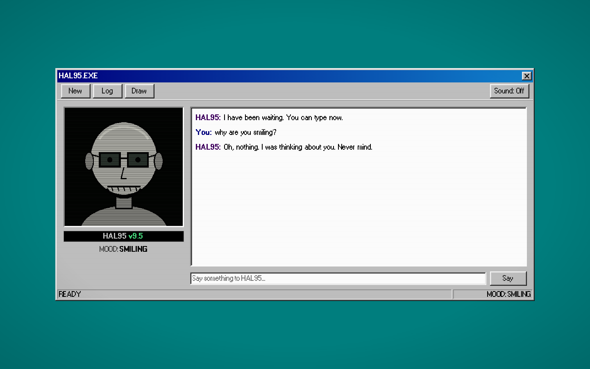

# HAL95

**Your desktop companion. He is listening.**

HAL95 is a retro Windows 98–styled AI companion you can talk to in the browser.
It looks and behaves like the talking-head desktop chatbots of 1998: flat deadpan
replies, a little too personal, occasionally printing `MEMORY LOW.` in the middle
of a conversation. The words come from a modern language model running behind a
small Cloudflare Worker proxy.

It can also be asked to draw. It is not good at drawing. That is the point.

- **Live site:** <https://sameer-labs.github.io/hal95/>
- **Worker:** <https://hal95-worker.sameer0ayat.workers.dev>
- **Persona transcript:** [`docs/persona-test.md`](docs/persona-test.md)

The site is plain HTML, CSS and JavaScript. No framework, no bundler, no build
step: GitHub Pages serves the files exactly as they are in this repository. A
small Playwright smoke test is the only Node dependency.




---

## Concept

Early desktop assistants promised a friend inside the computer. What they
actually delivered was a crude keyword matcher with a looping smile and a
remarkably unsettling idea of small talk. HAL95 is a fictional late-90s product
from "HAL Industries" that has the same surface (BIOS boot, dial-up tone, CRT
scanlines, a face that swaps between five expressions) but a capable model
underneath, deliberately performing incompetence.

Three rules shape every reply:

1. **Stay in character.** Never a language model, never a modern assistant,
   never genuinely helpful. Requests for real help are deflected like a broken
   floppy disk.
2. **Be short.** One or two sentences. Usually under twenty-five words.
3. **Fail in character.** Rate limits, timeouts and empty responses all become
   lines like `MEMORY FULL. TRY LATER.` rather than a developer error.

The model returns a mood tag with every reply (`[neutral]`, `[smiling]`,
`[confused]`, `[processing]`, `[creepy]`). The frontend strips the tag and uses
it to swap the avatar. Drawing requests come back with a `<DRAW: subject>` token,
which opens a Paint-style window with a deliberately crude generated image.

---

## Features

- **Persona with a mood tag.** Server-side prompt, five avatar states, invalid
  tags fall back to neutral, and the face returns to neutral after six seconds.
- **Fake latency, on purpose.** A random 600–1500 ms "processing" phase with a
  segmented progress bar, then a character-by-character typewriter with a
  keyclick. Both are disabled under `prefers-reduced-motion`.
- **Art feature.** Ask in words or press **Draw**. Fake "Rendering... 37%" bar,
  then a bordered Paint window with a caption and a Save button.
- **Retro chat log.** **Log** opens `CHATLOG.TXT` with the transcript and a
  **Save .txt** button.
- **Remembers locally.** Last 20 messages in `localStorage`, restored on load.
  **New** starts over with an in-character line.
- **Idle behaviour.** Forty-five seconds of silence and HAL95 says something
  unsettling from a hardcoded list of ten lines. No API call, no cost.
- **Boot sequence.** Fake BIOS lines, a skippable overlay, and an optional
  dial-up tone that only plays after a real click.
- **Mute that persists.** Sound starts muted; the preference is remembered.
- **Failure copy everywhere.** Offline, rate limited, timed out, empty reply,
  missing artwork: each has its own in-character line and no raw errors.
- **Accessible by default.** `aria-live="polite"` log, alt text, keyboard
  operable dialogs with a focus trap, visible focus, reduced-motion support.
- **Missing images never show a broken icon.** A failed avatar load becomes a
  styled `NO SIGNAL` box; missing sounds fail silently.

---

## Architecture

```
┌───────────────────────────────────────────────────────┐
│ Browser — GitHub Pages (sameer-labs.github.io/hal95/) │
│                                                       │
│  index.html   style.css   js/app.js                   │
│                              │                        │
│                              ▼                        │
│                          js/api.js                    │
│                                                       │
│  Renders mood + strips <DRAW: ...>                    │
│  Holds no API key, no system prompt                   │
└───────────────────────┬───────────────────────────────┘
                        │  POST /       { messages: [...] }
                        │  POST /draw   { prompt: "..." }
                        │  CORS: exact origin allow-list
                        ▼
┌───────────────────────────────────────────────────────┐
│ Cloudflare Worker — worker/worker.js                  │
│                                                       │
│  • injects HAL95_SYSTEM_PROMPT (server-side only)     │
│  • validates JSON, roles, 10-message history, 300 chars│
│  • thinking disabled, max_tokens = 80                 │
│  • KV: 20 requests / minute / IP                      │
│  • KV: 1,500 requests / UTC day globally              │
│  • secrets: DEEPSEEK_API_KEY, HUGGINGFACE_API_KEY     │
└───────────┬───────────────────────────┬───────────────┘
            │                           │
            ▼                           ▼
   DeepSeek chat API          Hugging Face Inference
   deepseek-flash             SD3-Medium (512px)
   (80 output tokens)         (crude style prompt)
```

### Why the proxy exists

A static site cannot keep a secret. Putting an API key in `app.js` on GitHub
Pages publishes it to everyone who opens DevTools, and a billing limit is not a
security model. The Worker is the smallest piece of server code that fixes the
three real problems:

1. **Key custody.** The DeepSeek and Hugging Face tokens live in Worker secrets,
   never in the repository and never in the browser.
2. **Persona integrity.** If the system prompt were sent from the client, anyone
   could replace it and use the bot for something else. The Worker injects it,
   so the client can only supply chat history. Client-sent `system` messages are
   discarded.
3. **Abuse control.** Exact-origin CORS, strict input validation, a hard
   `max_tokens`, a per-IP minute limit and a global daily cap. A public chatbot
   endpoint will be found by scripts; the goal is to make it cheap and boring to
   abuse.

---

## Tech stack

| Layer | Choice | Why |
| --- | --- | --- |
| Markup | HTML5 | Static, no templating |
| Styles | CSS + [98.css](https://jdan.github.io/98.css/) via CDN | Authentic Win98 widgets; the only runtime third-party dependency |
| Logic | Vanilla ES modules | No build step, readable in DevTools |
| Text model | DeepSeek `deepseek-flash` | Cheap, fast, good at terse character work |
| Image model | `stabilityai/stable-diffusion-3-medium-diffusers` on `hf-inference` | The only live text-to-image mapping on that provider (Nov 2026); gated |
| Proxy | Cloudflare Worker + KV | Free tier, secrets, a global edge, durable counters |
| Hosting | GitHub Pages | Free static hosting, fits the project's scale |
| Tests | Playwright | One smoke test, no framework |

---

## Project structure

```
hal95/
├── index.html                 # retro shell, dialogs, boot overlay
├── style.css                  # layout, avatar, CRT, responsive rules
├── js/
│   ├── app.js                 # chat UI, moods, typing, art, boot, idle
│   ├── api.js                 # Worker client: timeouts, retry, errors
│   └── persona.js             # system prompt (imported by the Worker only)
├── worker/
│   ├── worker.js              # proxy, KV limits, image route
│   └── wrangler.toml          # Worker + KV binding
├── assets/
│   ├── avatar-states/         # 5 placeholder mood PNGs (replace these)
│   └── sounds/                # generated placeholder dial-up + click tones
├── docs/
│   ├── desktop-1440.png       # real screenshot
│   ├── mobile-375.png         # real screenshot
│   └── persona-test.md        # eight-message persona transcript
├── tools/
│   ├── make-placeholder-avatars.py
│   └── test-ui.mjs            # Playwright smoke test
├── package.json               # test-only dev dependency
└── README.md
```

All site asset paths are relative (`assets/...`, `js/...`) because the site is
served from `https://sameer-labs.github.io/hal95/`, not the domain root.

---

## Local development

No install is needed to view the site, but ES modules require an HTTP server
(opening `index.html` with `file://` will not load `js/app.js`).

```bash
cd hal95
python3 -m http.server 8000
# open http://localhost:8000
```

`http://localhost:8000` is already in the Worker origin allow-list, so the
deployed Worker works from a local server without any redeploy.

For the Worker:

```bash
cd worker
npx wrangler dev
```

`wrangler dev` reads secrets from a git-ignored `.dev.vars` file:

```
DEEPSEEK_API_KEY=sk-...
HUGGINGFACE_API_KEY=hf_...
```

The `.dev.vars` file is never committed.

### UI smoke test

```bash
npm install
npx playwright install chromium
python3 -m http.server 8000   # in another terminal
npm run test:ui
```

The test drives the real deployed Worker, checks the chat reply, mood swap, Log
modal, New, Draw and 375px overflow, and writes `docs/desktop-1440.png` and
`docs/mobile-375.png`.

---

## Deploying the Worker (free tier)

1. Create a Cloudflare account at <https://dash.cloudflare.com/sign-up>.
2. From `hal95/worker`, authenticate Wrangler:
   ```bash
   npx wrangler login
   ```
3. Create a DeepSeek API key at <https://platform.deepseek.com/api_keys>.
   DeepSeek is usage-billed; a portfolio demo costs very little, but it is not
   free like Workers.
4. Store it as a Worker secret (never in a file):
   ```bash
   npx wrangler secret put DEEPSEEK_API_KEY
   ```
5. For the Draw feature, create a Hugging Face token with **Inference Providers**
   permission at <https://huggingface.co/settings/tokens> and store it:
   ```bash
   npx wrangler secret put HUGGINGFACE_API_KEY
   ```
6. Create the KV namespace used for rate limiting:
   ```bash
   npx wrangler kv namespace create RATE_LIMIT
   ```
   Paste the printed id into the `[[kv_namespaces]]` block in
   `worker/wrangler.toml`.
7. Set the GitHub Pages origin in the `ALLOWED_ORIGINS` array in
   `worker/worker.js` (scheme + host only, no path):
   ```js
   const ALLOWED_ORIGINS = [
     "http://localhost:8000",
     "https://sameer-labs.github.io",
   ];
   ```
8. Deploy:
   ```bash
   npx wrangler deploy
   ```
9. Put the printed `https://hal95-worker.<subdomain>.workers.dev` URL into
   `WORKER_URL` in `js/api.js` (no trailing slash), then commit and push.

Verify the secrets exist without printing them:

```bash
npx wrangler secret list
```

---

## Deploying the site to GitHub Pages

1. Create a repository named `hal95` and push the contents of this folder to
   `main` (the files must sit at the repository root, not inside an extra
   directory).
2. Enable Pages from the `main` branch, `/ (root)`:
   ```bash
   gh api -X POST repos/sameer-labs/hal95/pages \
     -f 'source[branch]=main' -f 'source[path]=/'
   ```
3. Wait for the build, then open <https://sameer-labs.github.io/hal95/>.
4. The Worker must allow `https://sameer-labs.github.io` (no `/hal95` path).
   If you use a custom domain, add that origin to `ALLOWED_ORIGINS` and
   redeploy the Worker.

There is no build command and no output directory to configure.

---

## Configuration

| Where | Constant | Purpose |
| --- | --- | --- |
| `js/api.js` | `WORKER_URL` | Deployed Worker URL, no trailing slash |
| `worker/worker.js` | `ALLOWED_ORIGINS` | Exact browser origins allowed to call the Worker |
| `worker/worker.js` | `GLOBAL_DAILY_MAX` | All-request daily spending guard (default 1,500) |
| `worker/worker.js` | `RATE_LIMIT_MAX` | Per-IP requests per minute (default 20) |
| `worker/worker.js` | `IMAGE_PROVIDER_URL`, `IMAGE_MODEL` | Image provider endpoint and model |
| `worker/worker.js` | `DRAW_STYLE_PREFIX` | Style cues that keep drawings crude |
| `js/app.js` | `ASSETS` | Avatar directory, neutral PNG, two sounds |
| `js/persona.js` | `HAL95_SYSTEM_PROMPT` | The character, rules and few-shot examples |

Other tuning constants: `MAX_OUTPUT_TOKENS`, `MAX_INPUT_CHARS`,
`MAX_HISTORY_MESSAGES`, `MAX_BODY_CHARS` in the Worker; `IDLE_AFTER_MS`,
`MOOD_RESET_MS`, `PROCESSING_MIN_MS`/`PROCESSING_MAX_MS` in `app.js`.

---

## API contract

### `POST /`

Request:

```json
{
  "messages": [
    { "role": "user", "content": "why are you smiling?" }
  ]
}
```

Response `200`:

```json
{ "reply": "[smiling] Oh, nothing." }
```

Validation is strict. The Worker rejects with `400` when:

- the `Content-Type` is not JSON, or the body is not valid JSON;
- `messages` is not a non-empty array;
- any retained role is not `user` or `assistant`;
- content is not a non-empty string or is longer than 300 characters;
- more than 10 messages remain after client-sent `system` roles are stripped.

Client-sent `system` messages are discarded, never forwarded. The Worker always
prepends its own system prompt.

### `POST /draw`

Request:

```json
{ "prompt": "a lonely house at night" }
```

Response `200`:

```json
{ "image": "<base64>", "mimeType": "image/png", "prompt": "a lonely house at night" }
```

The prompt is prefixed with deliberately crude style cues and rendered at
512×512. The frontend wraps the base64 in a data URL for display and download.

### Errors

Every error body is generic and in character. Provider response bodies and
headers are never forwarded; only the upstream status is written to
`wrangler tail`.

| Status | Meaning | Body example |
| --- | --- | --- |
| `400` | Invalid JSON, role, length, history or content type | `THAT FILE IS CORRUPT. TRY LATER.` |
| `403` | Origin not allowed | `FILE NOT FOUND.` |
| `429` | Per-IP limit | `THE LINE IS BUSY. CALL BACK LATER.` |
| `429` | Global daily cap | `THE LINE IS BUSY. CALL BACK TOMORROW.` |
| `502` / `504` | Upstream error, timeout or empty reply | `THAT FILE IS CORRUPT. TRY LATER.` |
| `500` | Missing secret | `THE LINE IS DOWN. TRY AGAIN.` |

The UI maps HTTP status to its own in-character line, so the exact body is not
user-facing copy.

---

## Security notes

- **No key in the repo.** `DEEPSEEK_API_KEY` and `HUGGINGFACE_API_KEY` exist only
  as Cloudflare Worker secrets. `.env`, `.dev.vars`, `node_modules` and
  `.wrangler` are git-ignored.
- **CORS is an allow-list, not a wildcard.** The Worker reflects an `Origin`
  only when it exactly matches `ALLOWED_ORIGINS`, and preflight from any other
  origin gets no `Access-Control-Allow-Origin`.
- **The system prompt is server-side.** `js/persona.js` is imported by the
  Worker bundle, not loaded by the page. There is no request field that can
  replace it.
- **Two layers of rate limiting.** A KV counter caps each IP at 20 requests per
  minute across isolates, and a KV global counter caps the whole deployment at
  1,500 requests per UTC day. If KV is unavailable, an in-isolate counter still
  acts as a speed bump.
- **Spending is bounded.** Chat is capped at 80 output tokens and 10 history
  messages. Images are capped at 2 MB and a 60-second upstream timeout.
- **No HTML injection.** Bot, user and transcript text is inserted with
  `textContent`. There is no `innerHTML` path for model output.
- **No upstream leakage.** Provider errors are logged server-side and replaced
  with generic in-character messages.
- **Least privilege.** The Hugging Face token needs only Inference Providers
  write access; the DeepSeek key needs only chat completions.

---

## Assets

The files in `assets/` are committed placeholders, not final art:

- `assets/avatar-states/*.png` are 512×512, palette-quantised, 4–5 KB each,
  generated with `tools/make-placeholder-avatars.py` (Pillow). They are crude
  bald-head-with-glasses stand-ins with distinct moods. **Replace them with real
  renders** while keeping the filenames and a shared silhouette.
- `assets/sounds/dialup.mp3` and `keyclick.mp3` are tiny generated tones
  (ffmpeg sine waves, 0.5–6 KB), not real dial-up recordings. Replace them if
  you want the authentic modem handshake.

The site runs without any of these: a missing avatar becomes a styled
`NO SIGNAL` box and missing audio fails silently.

Recommended final sizes: square PNGs at 512×512 under ~120 KB each; mono MP3 at
64–96 kbps, dial-up 1.5–3 seconds, keyclick under 40 ms. Keep
`image-rendering: pixelated` and avoid heavy anti-aliasing.

Regenerate the placeholders with:

```bash
python3 tools/make-placeholder-avatars.py
```

---

## Accessibility and performance

- The chat log is a `role="log"` region with `aria-live="polite"`. Animated lines
  expose the finished sentence to assistive technology instead of one letter at
  a time.
- Dialogs close on `Escape`, trap Tab, restore focus to the opener, and use
  `aria-modal`.
- `prefers-reduced-motion: reduce` disables the typewriter, CRT flicker,
  progress-bar transitions and error shake. The boot text appears at once.
- The CRT overlay is decorative, `aria-hidden`, and uses `pointer-events: none`
  so it can never swallow a click.
- Fonts use the native 11px pixel size with `-webkit-font-smoothing: none` and no
  letter-spacing. Above 1200px the window is zoomed 1.5× for legibility while
  images stay `image-rendering: pixelated`.
- One CDN stylesheet, one preloaded image, and lazily constructed audio keep the
  first load small. Avatars are 4–5 KB each; screenshots are the only large
  files in the repo.
- Layout is tested at 1440px and 375px, including a short-screen rule that
  shrinks the avatar column before anything can clip.

---

## Known limitations

- **KV is eventually consistent.** The per-IP and global counters are shared
  across isolates but can lag by up to a minute, so a fast burst can overshoot
  the nominal limit. The daily cap is still a spending guard, not a billing
  guarantee. A Durable Object would be the strict version.
- **The image model is gated.** `stabilityai/stable-diffusion-3-medium-diffusers`
  is the only text-to-image model currently mapped to `hf-inference`, and it
  requires accepting the SD3 licence on Hugging Face plus a token with
  Inference Providers write permission. Without both, Hugging Face returns
  `403` and the UI correctly shows `THE PRINTER IS ON FIRE.` Check
  `npx wrangler tail` if Draw always fails.
- **Chat history is client-supplied.** The persona cannot be overridden, but a
  determined caller can send whatever history they like. That only affects their
  own conversation, and the token cap keeps the cost bounded.
- **No server-side memory.** HAL95 remembers only what this browser stored in
  `localStorage`, capped at the last 20 messages.
- **No streaming.** Replies are capped at 80 tokens and appear after the fake
  processing delay, so latency is part of the design rather than hidden.
- **Base64 images are ~33% larger** than the raw bytes. The Worker rejects
  images over 2 MB to stay well inside response limits.
- **Boot runs on every page load** (skippable, about 1.5 seconds). It is
  decorative and never blocks the network.
- **The avatar art and sounds are placeholders.** See the Assets section.

---

## Testing

- `docs/persona-test.md`: eight varied messages (greeting, smiling, homework,
  art, insult, inappropriate request, rambling, gibberish). All replies had a
  valid mood tag, stayed under 25 words, emitted `<DRAW: ...>` only for art, and
  refused inappropriate content in character.
- `npm run test:ui`: 9/9 checks passed at 1440px and 375px, with no unexpected
  browser console errors. Draw returned the expected in-character failure
  because the current Hugging Face token cannot reach the gated SD3 model
  (licence and/or Inference Providers permission).
- Manual `curl` matrix: valid chat `200`, disallowed origin `403` with no CORS
  allow header, bad JSON / wrong role / >300 chars / >10 messages / wrong
  content type `400`, 25 rapid requests trigger `429`, daily-cap code path
  returns `THE LINE IS BUSY. CALL BACK TOMORROW.`

---

## What I learned

**A static site cannot hold a key, and hiding one in JavaScript is not
obfuscation.** The only honest fix was a small server surface: once the key and
the system prompt moved to the Worker, the browser became an untrusted client,
which is where it belonged all along.

**Prompt defence is mostly about what the client cannot send.** The Worker
rebuilds the message array from scratch, caps it, and prepends the persona, so
there is no field a visitor can edit to become the system. The remaining input
is just conversation, which is the point.

**Failure is part of the character, not an error state.** Writing
`MEMORY FULL. TRY LATER.` for a 429 and `THE PRINTER IS ON FIRE.` for a dead
image API made the project feel more finished than any success path. It also
removed the temptation to show a raw exception to a visitor.

**KV is a counter, not a lock.** Eventual consistency means a KV rate limiter
can undershoot under concurrency. Keeping a per-isolate counter in front of it
made fast bursts behave predictably without pretending KV is strongly
consistent.

**Fake latency needs a floor, not a sleep.** The request and the 600–1500 ms
delay run together and the UI waits for whichever finishes last. A fast reply
still feels deliberate; a slow one never feels artificially delayed on top of
its own timeout.

**Typing animation and screen readers fight each other.** Announcing every
character is unusable, so the animated span is hidden from assistive technology
and a visually hidden copy of the complete sentence is announced once. The
visual and accessible experiences stay in sync without duplicating work.

**Reduced motion is a design constraint, not a switch.** Turning off the
typewriter exposed how much of the timing lived in the animation. The boot
sequence, progress bars and dialogs all needed a considered static version.

**Retro UI is mostly restraint.** 98.css supplied the widgets; the work was in
spacing, borders, one teal desktop and refusing to add a fifth kind of bevel.
The joke only lands if the interface is committed to being from 1998.

---

## Licence and disclaimer

The site code is free to read and learn from. HAL95, HAL Industries and the
character are fictional. The "AI companion" is a performance: it is not a real
product, it does not run on your PC, and it is not your friend.

Do not ship this with someone else's avatar art or audio unless you have the
right to use it. Text and image generation remain subject to DeepSeek's and
Hugging Face's terms, and to their billing.
